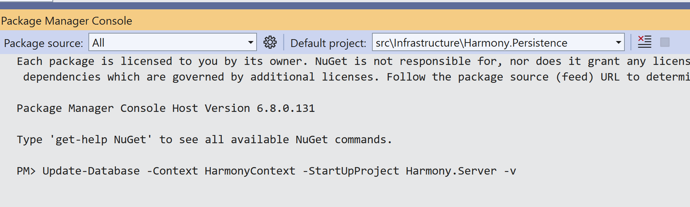

# PostgreSQL


PostgreSQL is optional and can be used instead of **SQL Server**. By default the repository is configured to run using SQL Server. In case you want to use SQL Server read [sql-server.md](sql-server.md "mention")



**Running with .NET Aspire?** Start the AppHost with the `https-postgres` launch profile, or set `Harmony:DatabaseProvider` to `PostgreSQL`. Aspire then starts a PostgreSQL container (host port **54333**, persistent volume `harmony-postgres-data`, plus pgAdmin). It creates the three databases and passes the connection strings and `DatabaseProvider=PostgreSQL` to the services, so nothing in this guide needs to be configured. See [aspire.md](../../aspire.md "mention").

With docker compose, use the PostgreSQL overlay: `docker compose -f docker-compose.yml -f docker-compose.postgres.yml up -d`. With Kubernetes, apply `.k8s/overlays/postgres`.


Harmony needs three **PostgreSQL** databases. PostgreSQL can be installed on Windows or Linux. After installing a PostgreSQL instance, configure the connection strings for the following three databases. Harmony creates them for you on startup.

1. **Harmony**: The core database used by the <mark style="color:blue;">Harmony.Api</mark> server app, containing all the core tables and their relationships, e.g. Workspaces, Boards or Cards.
2. **Harmony.Notifications.Jobs**: The database used by the <mark style="color:blue;">Harmony.Notifications</mark> web app, containing all the HangFire required tables and one more.
3. **Harmony.Automations.Jobs**: The database used by the <mark style="color:blue;">Harmony.Automations</mark> web app, containing all the HangFire required tables and one more.

### Harmony database configuration

#### Database connection string

Set **DatabaseProvider** to `PostgreSQL` and configure the <mark style="color:orange;">HarmonyConnection</mark> connection string in the <mark style="color:blue;">**appsettings.json**</mark> file at the root of the **Harmony.Api** project, pointing to your PostgreSQL instance.

```json
  "DatabaseProvider": "PostgreSQL",
  "ConnectionStrings": {
     "HarmonyConnection": "Host=localhost;Database=Harmony;Username=postgres;Password=MySecretPassword"
  }
```

More connection string options are described in the [Npgsql documentation](https://www.npgsql.org/doc/connection-string-parameters.html).

#### Database migrations


Since Harmony can be run either using **SQL Server** or **PostgreSQL**, there are two separate class library projects for the respective migrations:

* Harmony.Persistence.Migrations.SqlServer
* Harmony.Persistence.Migrations.PostgreSql

The PostgreSQL migrations live in **Harmony.Persistence.Migrations.PostgreSql**. In case you want to contribute and add a new migration, create it for both database providers.


You can run the database migrations either manually or **let the projects run them for you** during startup.

#### Run migrations through <mark style="color:blue;">Visual Studio</mark>

Open the `Package Manager Console` and set the `Default project` to **src\Infrastructure\Harmony.Persistence**. Make sure `DatabaseProvider` is `PostgreSQL` in the startup project's appsettings.json, or pass it explicitly with `-Args`:

```powershell
Update-Database -Context HarmonyContext -StartUpProject Harmony.Api -Args "--DatabaseProvider PostgreSQL"
```

<figure><figcaption><p>Run update migration for Harmony database</p></figcaption></figure>


Migrations command require that you have previously setup your database connection strings properly.


In case you decide to **create** a new migration, use the PostgreSQL migrations project:

```powershell
Add-Migration MyCustomMigrationName -OutputDir HarmonyContextMigrations -Context HarmonyContext -Project Harmony.Persistence.Migrations.PostgreSql -StartUpProject Harmony.Api -Args "--DatabaseProvider PostgreSQL"
```

#### Run migrations using a command line

First install the [EF Core tools](https://learn.microsoft.com/en-us/ef/core/cli/dotnet), or update them if you already have them:

```powershell
dotnet tool install --global dotnet-ef
dotnet tool update --global dotnet-ef
```

Open a terminal at the root of the **Harmony.Persistence** project, where the <mark style="color:blue;">HarmonyContext</mark> class exists, and run:

```powershell
dotnet ef database update --context HarmonyContext --startup-project "../../Services/Harmony.Api/Harmony.Api.csproj" -- --DatabaseProvider PostgreSQL
```

To add a new migration from the command line:

```powershell
dotnet ef migrations add MyCustomMigrationName -o HarmonyContextMigrations --context HarmonyContext --project ../Harmony.Persistence.Migrations.PostgreSql --startup-project "../../Services/Harmony.Api/Harmony.Api.csproj" -- --DatabaseProvider PostgreSQL
```


Just a reminder here: It's **optional** to run the migrations by yourself because they run by default at startup.


### Harmony.Notifications & Harmony.Automations jobs database configuration

#### Database connection string

Set **DatabaseProvider** to `PostgreSQL` and configure the _HarmonyJobsConnection_ connection strings in the <mark style="color:blue;">**appsettings.json**</mark> file at the root of the **Harmony.Notifications** & **Harmony.Automations** projects. The same setting also selects the PostgreSQL storage for HangFire.

#### Harmony.Notifications appsettings.json

```json
  "DatabaseProvider": "PostgreSQL",
  "ConnectionStrings": {
    "HarmonyJobsConnection": "Host=localhost;Database=Harmony.Notifications.Jobs;Username=postgres;Password=MySecretPassword"
  },
```

#### Harmony.Automations appsettings.json

```json
  "DatabaseProvider": "PostgreSQL",
  "ConnectionStrings": {
    "HarmonyJobsConnection": "Host=localhost;Database=Harmony.Automations.Jobs;Username=postgres;Password=MySecretPassword"
  },
```

#### Database migrations

Use the same commands as for the Harmony database, changing the context and the startup project.

**Applying migrations via dotnet-ef tools:**

```powershell
dotnet ef database update --context NotificationContext --startup-project "../../Services/Harmony.Notifications/Harmony.Notifications.csproj" -- --DatabaseProvider PostgreSQL
```

```powershell
dotnet ef database update --context AutomationContext --startup-project "../../Services/Harmony.Automations/Harmony.Automations.csproj" -- --DatabaseProvider PostgreSQL
```

**Applying migrations using Visual Studio package manager console:**

```powershell
Update-Database -Context NotificationContext -StartUpProject Harmony.Notifications -Args "--DatabaseProvider PostgreSQL"
```

```powershell
Update-Database -Context AutomationContext -StartUpProject Harmony.Automations -Args "--DatabaseProvider PostgreSQL"
```

**Adding migrations:**

```powershell
Add-Migration MyCustomMigrationName -OutputDir NotificationContextMigrations -Context NotificationContext -Project Harmony.Persistence.Migrations.PostgreSql -StartUpProject Harmony.Notifications -Args "--DatabaseProvider PostgreSQL"
```

```powershell
Add-Migration MyCustomMigrationName -OutputDir AutomationContextMigrations -Context AutomationContext -Project Harmony.Persistence.Migrations.PostgreSql -StartUpProject Harmony.Automations -Args "--DatabaseProvider PostgreSQL"
```

#### Read next - configure the MongoDB Server


[mongodb-server.md](mongodb-server.md)

