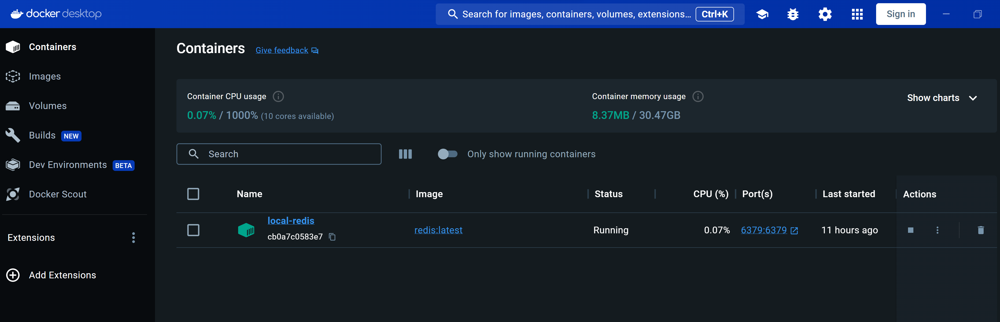
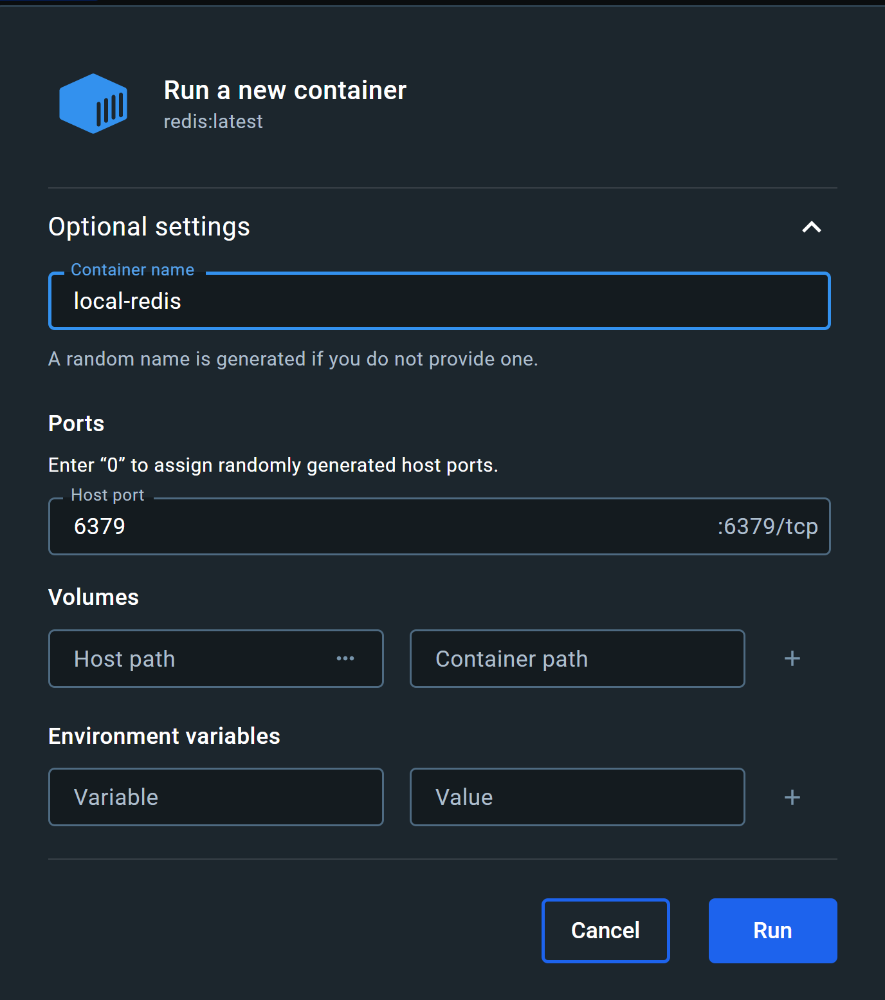

# Redis

[Redis](https://redis.io/) is an open-source in-memory data store. Harmony uses it in two ways:

* **SignalR backplane**: clients connect to an instance of <mark style="color:blue;">**Harmony.SignalR**</mark> through the API gateway to receive instant updates via WebSocket. A [Redis backplane](https://learn.microsoft.com/en-us/aspnet/core/signalr/redis-backplane?view=aspnetcore-10.0) supports the scenario where you run multiple Harmony.SignalR instances and different clients are connected to different instances. Applications send messages to Harmony.SignalR via RabbitMQ.
* **Distributed cache** for <mark style="color:blue;">**Harmony.Api**</mark> & <mark style="color:blue;">**Harmony.Automations**</mark>. Read the [caching.md](../caching.md "mention") guide.


Installing Redis is optional for local development. You need it when you run more than one instance of **Harmony.SignalR**, or when you want distributed caching.

**.NET Aspire**, docker compose and Kubernetes all run a Redis instance for you and use it both as the backplane and as the cache.


### Installation

Follow the official installation [instructions](https://redis.io/docs/install/install-redis/) for installing Redis on your environment. The easiest way to run a Redis instance locally is with a docker container. Expose a port outside the container so that other apps can connect to it.

<figure><figcaption></figcaption></figure>

<figure><figcaption></figcaption></figure>

### Configuration

Set the **RedisConnectionString** property in the **appsettings.json** of Harmony.SignalR. The SignalR backplane is enabled when the value isn't empty. The following configuration connects to a local Redis instance listening on the default 6379 port.

```json
"RedisConnectionString": "127.0.0.1:6379",
```

Any [StackExchange.Redis connection string](https://stackexchange.github.io/StackExchange.Redis/Configuration.html) is supported, for example with a password or TLS:

```json
"RedisConnectionString": "localhost:6380,password=MyPassword,ssl=true",
```


The <mark style="color:blue;">**Harmony.Client**</mark> only needs the **gatewayUrl** setting in **wwwroot/appsettings.json**. The SignalR hub is reached through the API gateway at `{gatewayUrl}/signalRHub`.



With [aspire.md](../../aspire.md "mention"), Redis runs as a container (host port 6380, volume `harmony-redis-data`, plus RedisInsight). The AppHost sets `RedisConnectionString` on Harmony.SignalR, Harmony.Api and Harmony.Automations, and `CacheProvider=Redis` on the latter two.


&#x20;Read next - Configure RabbitMQ


[rabbitmq.md](../rabbitmq.md)

