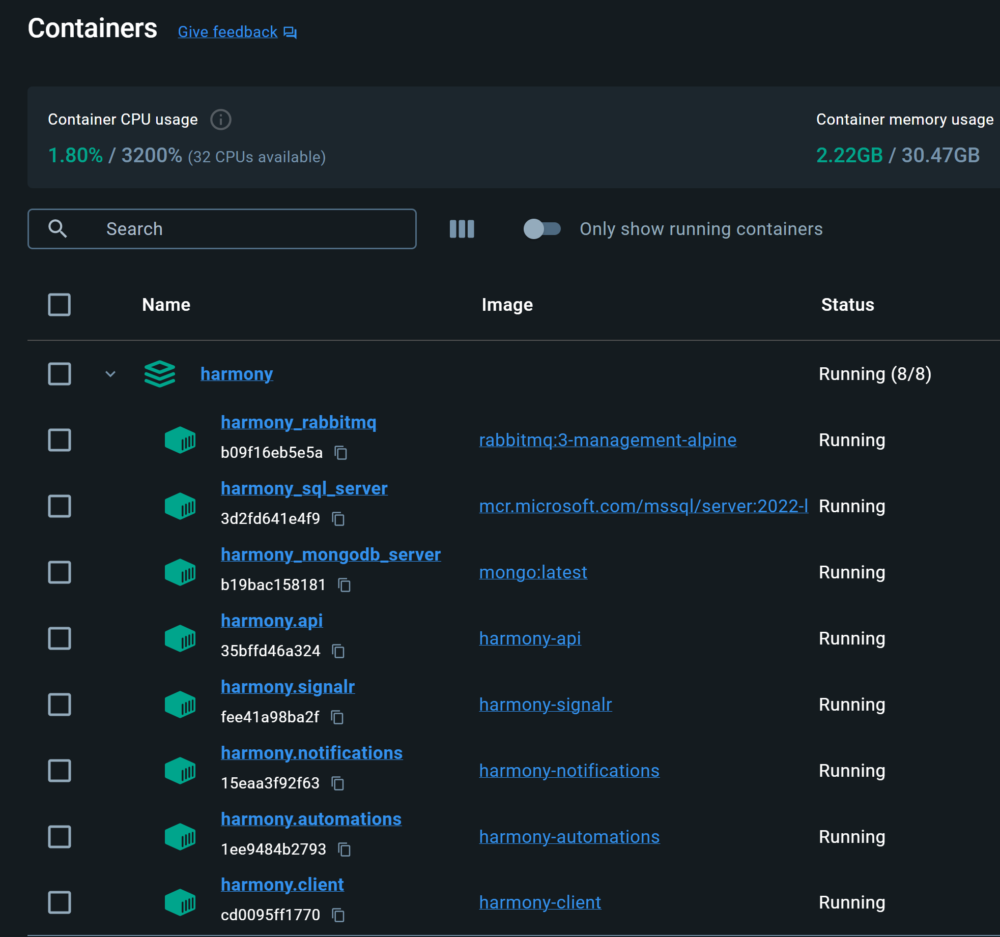

# 🐳 Docker

Harmony has a clean, microservice architecture, and [**docker**](https://www.docker.com/) builds and runs the entire infrastructure with just a few commands.&#x20;

<figure><figcaption><p>Harmony containers</p></figcaption></figure>

The following instructions will guide you to build Harmony's images and run its containers on your local machine using docker compose. In case you want to deploy to a local Kubernetes cluster read the [Kubernetes](kubernetes.md) section.


For day-to-day development and debugging, [.NET Aspire](../aspire.md) is usually more convenient. It runs the infrastructure as containers and the Harmony services from your IDE with the debugger attached. Use docker compose when you want to run everything, including the Harmony services, as containers.


#### Create and trust a development certificate

Open a PowerShell session and run the following commands to create and trust a development certificate, since all Harmony applications run under HTTPS.

```powershell
dotnet dev-certs https -ep $env:USERPROFILE\.aspnet\https\harmony.pfx -p HarmonyTeamsSecretKey
dotnet dev-certs https --trust
```

The above commands are for **Windows using Linux** containers. If you are on a **Mac** or **Linux** you need to run:

```powershell
dotnet dev-certs https -ep ${HOME}/.aspnet/https/harmony.pfx -p HarmonyTeamsSecretKey
dotnet dev-certs https --trust
```

Please read the official Microsoft's [guide](https://learn.microsoft.com/en-us/aspnet/core/security/docker-compose-https?view=aspnetcore-10.0) for more details in case you face any problems. The previous commands used the password _HarmonyTeamsSecretKey_ but you can use your own. If you do, set it as `HARMONY_CERT_PASSWORD` in the **.env** file (see below).

#### Settings and credentials (.env)

All credentials and host ports are read from environment variables with development defaults, so the **.env** file is optional. To change them, copy **.env.example** to **.env** at the root of the solution (it is git-ignored) and edit the values:

```properties
HARMONY_CERT_PASSWORD=HarmonyTeamsSecretKey
SQL_SA_PASSWORD=%HarmonyTeams100
MONGO_USER=harmony
MONGO_PASSWORD=HarmonyMongo100
RABBITMQ_USER=harmony
RABBITMQ_PASSWORD=HarmonyRabbit100
REDIS_PASSWORD=HarmonyRedis100
POSTGRES_USER=postgres
POSTGRES_PASSWORD=HarmonyPostgres100
```

The file also contains `HARMONY_CERT_DIR` (the folder of harmony.pfx) and `*_HOST_PORT` variables. Use them to move the exposed infrastructure ports if they collide with something on your machine.

#### Build docker images and run the containers

Navigate to the root of Harmony's solution folder where the _**docker-compose.yml**_ file exists and run the following commands:

```docker
docker compose build
docker compose up -d
```

Infrastructure containers have health checks, and the Harmony services start only after the databases and the broker report healthy.


In case you are running Harmony via Visual Studio or Aspire, stop it before running `docker compose up`, because the containers expose the same ports (7096, 7097, 7108, 7113, 7121, 7262, 7277). The infrastructure ports are exposed for your convenience (SQL Server 1433, MongoDB 27017, RabbitMQ 5672 / 15672, Redis 6379). If your own local servers already use them, change the `*_HOST_PORT` variables in **.env**.


#### Open Harmony

| | URL |
| --- | --- |
| Harmony | [http://localhost:7096/](http://localhost:7096/) |
| Aspire dashboard (traces, metrics, structured logs) | [http://localhost:18888](http://localhost:18888) |
| Kibana | [http://localhost:5601](http://localhost:5601) |
| RabbitMQ management | [http://localhost:15672](http://localhost:15672) |


The standalone Blazor WASM project <mark style="color:blue;">Harmony.Client</mark> is served by **Nginx** over HTTP.


Every service sends OpenTelemetry traces, metrics and logs to the standalone **Aspire dashboard** container (`harmony-aspire-dashboard`). Logs also go to Elasticsearch, see [distributed-logging.md](distributed-logging.md "mention").

#### Containers

| Service | Container | Notes |
| ------- | --------- | ----- |
| api, automations, notifications, signalr, integrations-sourcecontrol, api\_gateway, client | `harmony-api`, `harmony-automations`, `harmony-notifications`, `harmony-signalr`, `harmony-integrations-sourcecontrol`, `harmony-apigateway`, `harmony-client` | Images `harmony-<service>:latest` (also used by Kubernetes) |
| sql\_server | `harmony-sql-server` | SQL Server 2022, volume `harmony_sqlserver-data` |
| mongodb | `harmony-mongodb-server` | Authentication enabled (root user `harmony`), volume `harmony_mongodb-data` |
| rabbitmq | `harmony-rabbitmq` | User `harmony`, volume `harmony_rabbitmq-data` |
| redis | `harmony-redis` | Password protected, cache + SignalR backplane, volume `harmony_redis-data` |
| elasticsearch / kibana | `elasticsearch` / `kibana` | Volume `harmony_elasticsearch-data` |
| aspire-dashboard | `harmony-aspire-dashboard` | OpenTelemetry UI |

#### Persistence

All databases store their data in **named docker volumes** (`harmony_sqlserver-data`, `harmony_mongodb-data`, `harmony_rabbitmq-data`, `harmony_redis-data`, `harmony_elasticsearch-data`, and `harmony_postgres-data` with PostgreSQL). Your data survives `docker compose down`, `docker compose up --force-recreate`, image updates and machine restarts.

```docker
docker compose down        # stops and removes the containers, keeps the data
docker compose down -v     # also deletes the volumes, i.e. ALL data
```


Database passwords are written into the volumes on first start. If you change a password in **.env** later, either change it inside the database as well, or reset the data with `docker compose down -v`.


#### Use PostgreSQL instead of SQL Server

The **docker-compose.postgres.yml** overlay adds a `harmony-postgres` container, switches `DatabaseProvider` and the connection strings of Harmony.Api, Harmony.Automations & Harmony.Notifications to PostgreSQL, and leaves SQL Server out:

```docker
docker compose -f docker-compose.yml -f docker-compose.postgres.yml up -d
```


The overlay requires Docker Compose **v2.24** or later.


#### Connect to your own SQL Server outside docker

If you want to connect to your host's SQL Server rather than to the SQL Server container, follow these steps:

1. Remove the `sql_server` service from the **docker-compose.yml** file and the `sql_server` entries from the _depends\_on_ sections of api, automations & notifications.
2. Enable **TCP/IP** access on your SQL Server instance & restart SQL Server services.
3. Ensure your SQL Server runs under mixed mode, so that you can connect with user & password credentials _(windows authentication won't work from a linux container!)_
4. Change the connection strings in the _docker-compose.yml_ file to connect to your SQL Server. For localhost development, you must use **host.docker.internal** as in the following example _(use your own credentials)_:

```yaml
ConnectionStrings__HarmonyJobsConnection: Server=host.docker.internal,1433;Database=Harmony.Automations.Jobs;User Id=harmony_user;Password=%HarmonyTeams100;TrustServerCertificate=True
```


[kubernetes.md](kubernetes.md)



[distributed-logging.md](distributed-logging.md)

