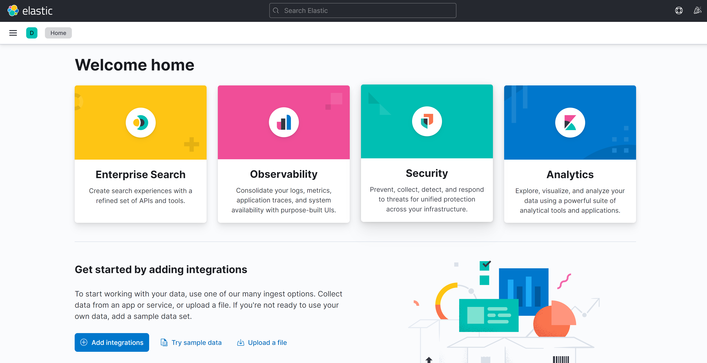
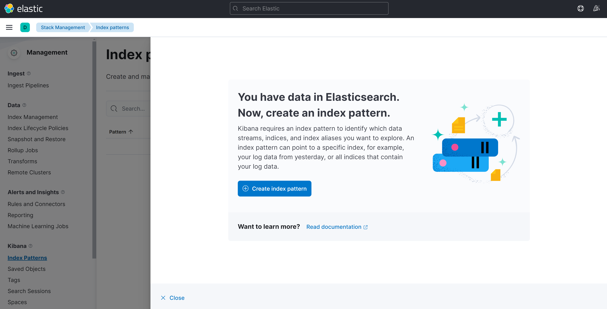
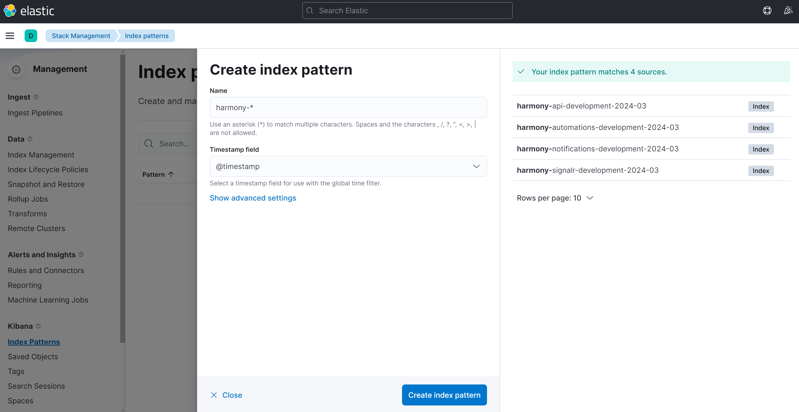
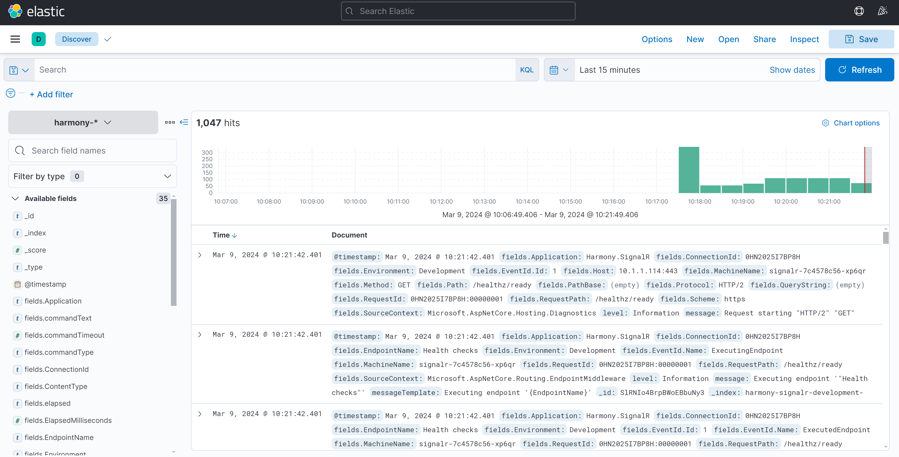

# 📝 Distributed logging

Every Harmony service exports **OpenTelemetry** logs, traces and metrics, and logs through **Serilog**. Two places can show them:

* The **Aspire dashboard**: structured logs, distributed traces and metrics of all services, with every log entry linked to its trace. Always available.
* **Kibana & Elasticsearch**: centralized log search and visualization through the Serilog Elasticsearch sink. Optional.

### Aspire dashboard (OpenTelemetry)

| How you run Harmony | Dashboard |
| ------------------- | --------- |
| [.NET Aspire](../aspire.md) (`aspire run` / Harmony.AppHost) | [https://localhost:17180](https://localhost:17180). The login link is printed in the console. |
| docker compose | [http://localhost:18888](http://localhost:18888) (`harmony-aspire-dashboard` container) |
| Kubernetes | [http://localhost:18888](http://localhost:18888) (`aspire-dashboard` service) |

Services export telemetry whenever the `OTEL_EXPORTER_OTLP_ENDPOINT` environment variable is set. Aspire, docker compose and Kubernetes set it for you. Open **Structured logs** to search the logs of all services, and **Traces** to follow a single request across the gateway, Harmony.Api, RabbitMQ and the consumers.

### Kibana & Elasticsearch

[Kibana](https://www.elastic.co/kibana) & [Elasticsearch](https://www.elastic.co/) provide centralized log search. The services send their logs to Elasticsearch when `ElasticConfiguration:Uri` is set, and Kibana searches, aggregates and visualizes them.

* **docker compose** & **Kubernetes**: Elasticsearch & Kibana are always deployed.
* **.NET Aspire**: set `Harmony:EnableElasticsearch` to `true` in the AppHost settings. See [aspire.md](../aspire.md "mention").

### Configure Kibana for searching

Kibana should be up and running on port **5601**.

1. Navigate to [http://localhost:5601/app/home#/](http://localhost:5601/app/home#/) to open Kibana's interface. If it's the first time you will see a welcome message, just click **Explore on my own**.

<figure><figcaption>
Welcome to Elastic
</figcaption></figure>

 

<figure><figcaption>
Kibana
</figcaption></figure>

2. Open the left sidebar and find **Kibana index patterns** in the management menu, in order to create an index pattern for harmony. Alternatively, navigate to [http://localhost:5601/app/management/kibana/indexPatterns](http://localhost:5601/app/management/kibana/indexPatterns). Click **Create index pattern** and fill the following values:

* Name: **harmony-\***
* Timestamp field: **@timestamp**

<figure><figcaption>
Create index pattern
</figcaption></figure>

<figure><figcaption>
Index pattern for Harmony
</figcaption></figure>

3. Your index pattern is good to go. Select **Discover** from the left sidebar and start searching!

<figure><figcaption>
Search with Kibana
</figcaption></figure>
