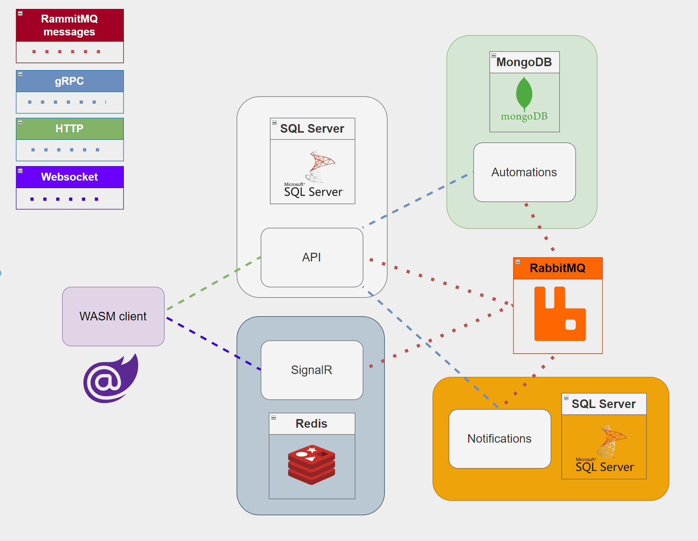
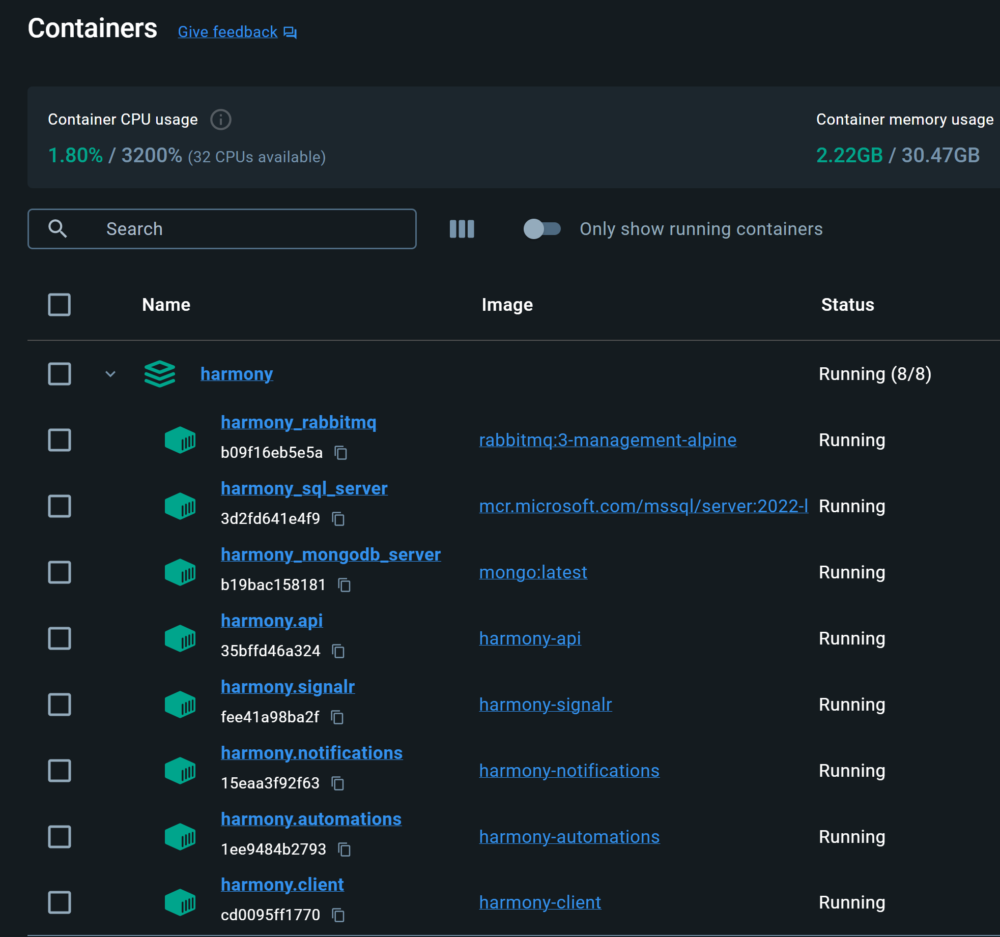

# 🔥 Technology

Harmony's **codebase** is a state of the art & [_dockerized_](../configuration/docker/) :whale: solution, built with best practices, patterns and a clean microservice architecture. You will be impressed by how easily can be scaled and maintained on a codebase level by adding new features or on infrastructure level by scaling horizontally.&#x20;


If you are an engineer or developer, you will be certainly benefit just by studying its codebase.


The stack, tools, frameworks used in Harmony are the following:

| Databases                           | Server                                                                                   | Front                                                                    |
| ----------------------------------- | ---------------------------------------------------------------------------------------- | ------------------------------------------------------------------------ |
| SQL Server or PostgreSQL            | .NET 10                                                                                   | [Blazor](https://dotnet.microsoft.com/en-us/apps/aspnet/web-apps/blazor) |
| [MongoDB](https://www.mongodb.com/) | SignalR                                                                                   | [MudBlazor](https://mudblazor.com/)                                      |
| Redis                               | [gRPC](https://learn.microsoft.com/en-us/aspnet/core/grpc/?view=aspnetcore-10.0) :rocket: |                                                                          |

| Data Access      | Patterns           | Messaging                         |
| ---------------- | ------------------ | --------------------------------- |
| Entity Framework | Clean architecture | [RabbitMQ](https://rabbitmq.com/) |
| Dapper           | CQRS MediatR       |                                   |
|                  |                    |                                   |

| Orchestration & local development                                                           | Observability                                                                  | Gateway                                       |
| -------------------------------------------------------------------------------------------- | ------------------------------------------------------------------------------ | --------------------------------------------- |
| [.NET Aspire](https://learn.microsoft.com/en-us/dotnet/aspire/get-started/aspire-overview) | [OpenTelemetry](https://opentelemetry.io/) traces, metrics & logs              | [Ocelot](https://github.com/ThreeMammals/Ocelot) |
| Docker compose & Kubernetes (kustomize)                                                      | Aspire dashboard, Serilog, Elasticsearch & Kibana                              |                                               |

<figure><figcaption>
Harmony architecture
</figcaption></figure>

#### Docker containers

Harmony is entirely dockerised with [Kubernetes](../configuration/docker/kubernetes.md) support. For local development, [.NET Aspire](../configuration/aspire.md) starts the whole stack with a single command.

<figure><figcaption></figcaption></figure>

#### Read next - Configure Harmony


[dependencies](../configuration/dependencies/)

